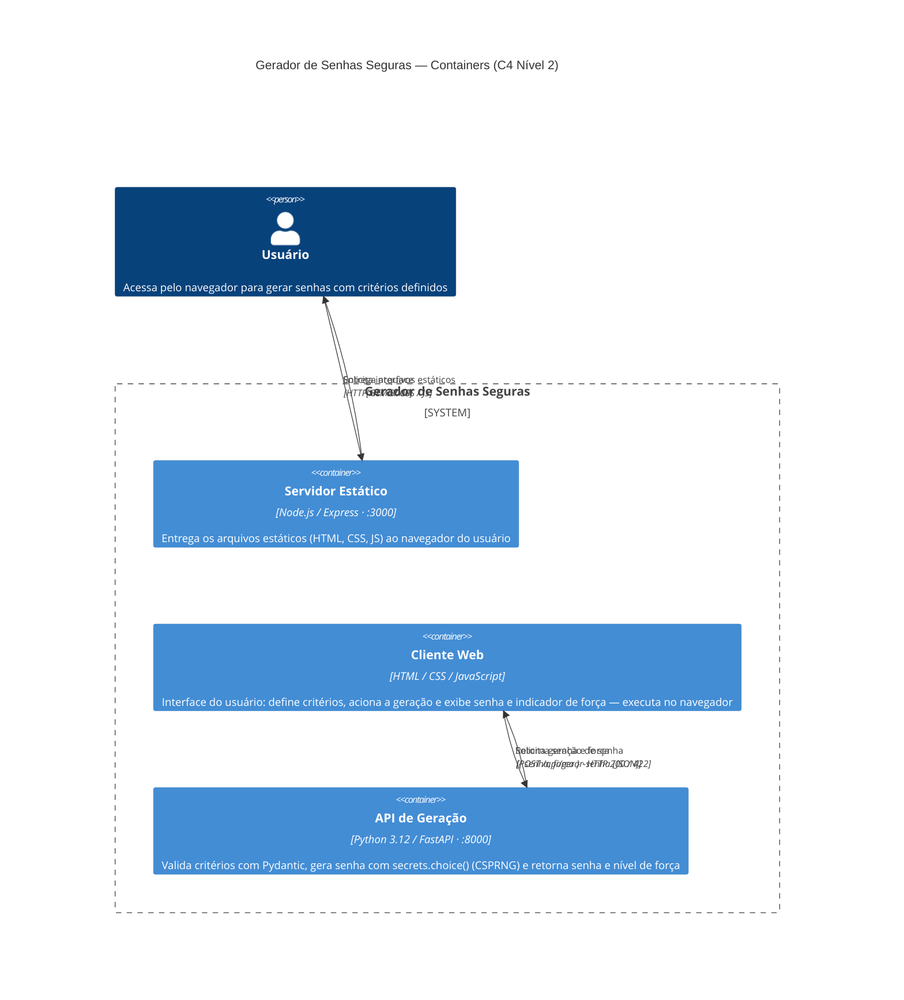
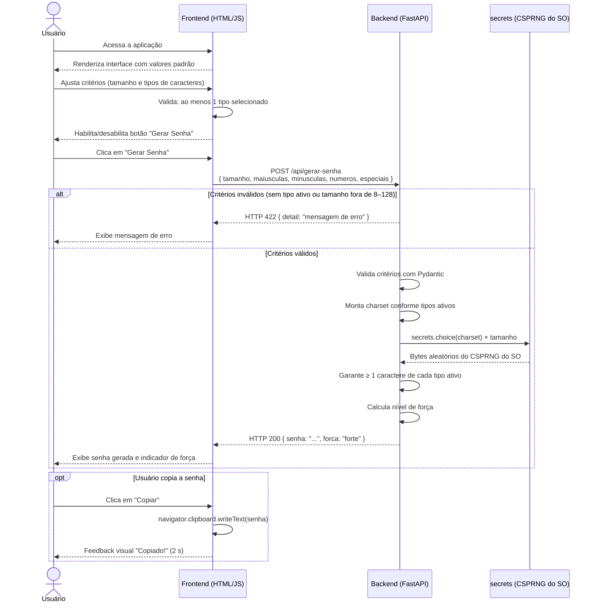
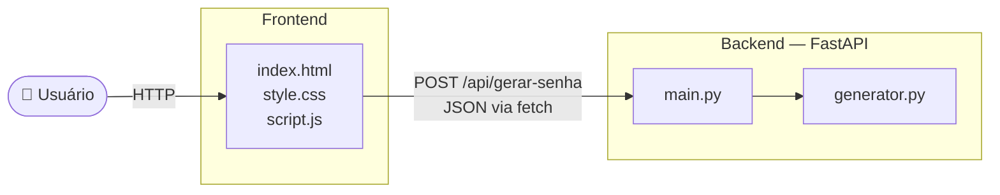

# Gerador de Senhas Seguras

Aplicação web para geração de senhas seguras com critérios definidos pelo usuário.

**Stack:** Python (FastAPI) · HTML · CSS · JavaScript

---

## Início rápido

> Pré-requisitos: [Python 3.12+](#pré-requisito-python-312-ou-superior), [uv](#opção-b--instalação-com-uv-mais-rápido) e [Node.js LTS](#pré-requisito-nodejs-lts) instalados.  
> No WSL/Linux, instale o `make` com `sudo apt install make` caso ainda não tenha.

```bash
# 1. Instalar todas as dependências
make install

# 2. Iniciar backend e frontend juntos
make start
```

A aplicação estará disponível em **http://localhost:3000**.  
O backend em **http://127.0.0.1:8000** (documentação interativa em `/docs`).

### Todos os comandos disponíveis

Execute `make` (sem argumentos) para ver o help completo:

```
make install              Instala todas as dependências (backend + frontend)
make backend-install      Instala dependências do backend com uv
make frontend-install     Instala dependências do frontend com npm

make start                Inicia backend e frontend simultaneamente
make backend-start        Inicia apenas o backend  → http://127.0.0.1:8000
make frontend-start       Inicia apenas o frontend → http://localhost:3000

make test                 Executa todos os testes
make test-integracao      Executa apenas os testes de integração (frontend ↔ backend)
make coverage             Testes com relatório de cobertura no terminal
make coverage-html        Testes com relatório HTML em backend/htmlcov/

make health               Verifica se o backend está respondendo
make audit                Auditoria de segurança das dependências
make deps-check           Lista dependências desatualizadas
make clean                Remove arquivos gerados (venv, cache, node_modules)
```

---

## Discovery de Arquitetura

> Esta seção documenta o sistema em linguagem natural e em Mermaid (diagrams as code), tornando a arquitetura versionável, revisável e reprodutível. Os diagramas foram gerados com auxílio do **Claude Sonnet 4.6** e ajustados — decisões em [Ajustes nos diagramas gerados](#ajustes-nos-diagramas-gerados); histórico de prompts em [PROMPTS.md](PROMPTS.md).

### Descrição do Sistema

**Escopo**

Aplicação web utilitária de sessão única: o usuário define critérios — comprimento e tipos de caracteres — e recebe uma senha gerada com técnica criptograficamente segura no servidor. Não há autenticação, persistência de dados ou estado compartilhado entre sessões.

**Nível da visão**

Container (C4 Nível 2): a descrição detalha os três containers que compõem o sistema — o servidor de arquivos estáticos, o cliente JavaScript executado no navegador e a API backend.

**Limites e responsabilidades**

| Container | Tecnologia | Responsabilidade |
|-----------|-----------|-----------------|
| Servidor Estático | Node.js / Express | Entrega os arquivos HTML, CSS e JS ao navegador na porta 3000 |
| Cliente Web | HTML / CSS / JavaScript | Captura critérios, valida seleção mínima, chama a API e exibe o resultado |
| API Backend | Python 3.12 / FastAPI | Valida critérios com Pydantic, gera senha com `secrets.choice()` (CSPRNG) e calcula força |

**Integrações**

Nenhuma integração externa. A única comunicação é interna: o cliente web envia `POST /api/gerar-senha` ao backend via `fetch`. Não há banco de dados, fila de mensagens ou serviços de terceiros.

**Restrições**

- A senha nunca é armazenada — backend completamente stateless.
- Toda geração usa exclusivamente `secrets.choice()` (CSPRNG do SO), nunca `random`.
- CORS controlado por variável de ambiente `ALLOWED_ORIGINS` — restrito em produção.
- A senha trafega em texto claro na resposta HTTP, exigindo TLS em produção.

**Lacunas identificadas**

| Lacuna | Risco | Mitigação futura |
|--------|-------|-----------------|
| Sem HTTPS nativo | Senha exposta em redes não confiáveis | TLS com Let's Encrypt + Certbot |
| Sem rate limiting | API suscetível a abuso por automação | `slowapi` no FastAPI |
| Swagger UI exposto | Superfície desnecessária em produção | `docs_url=None` quando `ENV=production` |
| Sem testes E2E | Fluxo completo de interação não coberto | Playwright |
| Sem modo offline | Aplicação inacessível sem servidor ativo | PWA + service worker |

---

### Diagrama Estrutural — Visão de Containers (C4 Nível 2)

> Gerado por IA (Claude Sonnet 4.6) e ajustado — decisões em [Ajustes nos diagramas gerados](#ajustes-nos-diagramas-gerados).



---

### Diagrama Comportamental — Sequência da Jornada Crítica

> A jornada crítica é a geração de senha: da definição de critérios pelo usuário até a exibição do resultado, incluindo o caminho de erro HTTP 422 e a etapa opcional de cópia.

> Gerado por IA (Claude Sonnet 4.6) e ajustado — decisões em [Ajustes nos diagramas gerados](#ajustes-nos-diagramas-gerados).



---

### Ajustes nos diagramas gerados

#### Diagrama estrutural (C4 Containers)

**Rascunho inicial gerado pela IA**

O modelo produziu um `graph LR` simples com três nós — Usuário → Frontend → Backend — sem distinção entre servidor estático e cliente JavaScript, sem tecnologias indicadas e sem portas de rede.

**Ajustes aplicados**

| # | Ajuste | Motivação |
|---|--------|-----------|
| 1 | Migração de `graph LR` para `C4Container` | Adota notação C4 padronizada e torna explícito o nível de abstração (Nível 2 — Containers) |
| 2 | Separação entre Servidor Estático e Cliente Web | O modelo tratou "Frontend" como um único bloco; a distinção é importante — um roda em Node.js no servidor, o outro executa no navegador do usuário |
| 3 | Tecnologia e porta em cada container | Torna o diagrama acionável como especificação técnica para implementação |
| 4 | Setas de resposta explícitas | O modelo omitiu os retornos; adicionei `Rel` com payload JSON e códigos HTTP para documentar o contrato de comunicação |

#### Diagrama comportamental (Sequência)

**Rascunho inicial gerado pela IA**

O modelo gerou uma sequência com três participantes (Usuário, Frontend, Backend) cobrindo o fluxo feliz e o caso de erro HTTP 422 — estrutura correta, mas sem detalhar o processo interno do backend nem o papel do CSPRNG.

**Ajustes aplicados**

| # | Ajuste | Motivação |
|---|--------|-----------|
| 1 | Adição do participante `secrets (CSPRNG do SO)` | O CSPRNG é o componente central da garantia de segurança; ocultá-lo equipararia o diagrama ao de qualquer gerador que use `random` |
| 2 | Detalhamento do fluxo interno do backend | O modelo colapsou tudo em uma etapa; expandi em: validação → charset → CSPRNG → cobertura de tipos → força, tornando o diagrama uma especificação de comportamento |
| 3 | Condição do `alt` mais precisa | A condição original era genérica ("Parâmetros inválidos"); especifiquei as duas regras de negócio que disparam HTTP 422 |
| 4 | Cópia movida para bloco `opt` | O fluxo de cópia era tratado como etapa obrigatória; movi para `opt` porque copiar é opcional e independente da geração da senha |

---

## Ciclo de Desenvolvimento

- [Fase 1 — Levantamento de Requisitos](#fase-1--levantamento-de-requisitos)
- [Fase 2 — Projeto](#fase-2--projeto)
- [Fase 3 — Codificação](#fase-3--codificação)
- [Fase 4 — Testes e Validação](#fase-4--testes-e-validação)
- [Fase 5 — Manutenção](#fase-5--manutenção)
- [Próximos Passos](#próximos-passos)

---

## Fase 1 — Levantamento de Requisitos

### Requisitos Funcionais

| ID    | Requisito |
|-------|-----------|
| RF01  | O usuário define o tamanho da senha (entre 8 e 128 caracteres) |
| RF02  | O usuário pode incluir/excluir letras maiúsculas (A-Z) |
| RF03  | O usuário pode incluir/excluir letras minúsculas (a-z) |
| RF04  | O usuário pode incluir/excluir números (0-9) |
| RF05  | O usuário pode incluir/excluir caracteres especiais (`!@#$%^&*()_+-=[]{}|;':",.<>?/`) |
| RF06  | O sistema gera uma senha por vez com base nos critérios selecionados |
| RF07  | O usuário pode copiar a senha gerada com um clique |
| RF08  | O sistema exibe um indicador de força da senha gerada |

### Requisitos Não-Funcionais

| ID     | Requisito |
|--------|-----------|
| RNF01  | A geração de senha é feita no backend (FastAPI/Python) por segurança |
| RNF02  | A senha nunca é armazenada ou logada no servidor |
| RNF03  | A API deve responder em menos de 500ms |

### Regras de Negócio

| ID    | Regra |
|-------|-------|
| RN01  | Pelo menos um tipo de caractere deve estar selecionado |
| RN02  | O tamanho da senha deve ser entre 8 e 128 caracteres |
| RN03  | A senha gerada deve conter ao menos 1 caractere de cada tipo selecionado |

### Decisões tomadas

- **Tamanho:** range de 8 a 128 caracteres.
- **Caracteres especiais:** conjunto completo — `!@#$%^&*()_+-=[]{}|;':",.<>?/`.
- **Quantidade:** uma senha por geração.
- **Histórico:** sem persistência; cada sessão é independente.
- **Comunicação:** API REST com FastAPI (Python) consumida pelo frontend via `fetch`.

---

## Fase 2 — Projeto

### Arquitetura

A aplicação segue uma arquitetura cliente-servidor simples, sem banco de dados:

```
gerador-senhas/
├── backend/
│   ├── main.py           # FastAPI app, rotas e CORS
│   ├── generator.py      # Lógica de geração e cálculo de força
│   ├── models.py         # Modelos Pydantic (request/response)
│   └── requirements.txt
├── frontend/
│   ├── index.html
│   ├── style.css
│   └── script.js
└── docs/
    ├── casos-de-uso.md
    ├── fluxo-geracao.md
    └── sequencia-api.md
```



### Diagramas

- [Casos de Uso](docs/casos-de-uso.md)
- [Fluxo de Geração de Senha](docs/fluxo-geracao.md)
- [Sequência — Frontend ↔ Backend e Contrato da API](docs/sequencia-api.md)

### Contrato da API

**`POST /api/gerar-senha`**

Request:
```json
{ "tamanho": 16, "maiusculas": true, "minusculas": true, "numeros": true, "especiais": false }
```

Response `200`:
```json
{ "senha": "aB3xYmQpLz7wNkRe", "forca": "forte" }
```

Response `422`:
```json
{ "detail": "Pelo menos um tipo de caractere deve ser selecionado." }
```

### Cálculo de Força da Senha

| Força | Critério |
|-------|----------|
| Fraca | apenas 1 tipo **ou** tamanho < 10 |
| Média | 2 tipos **e** tamanho ≥ 10 |
| Forte | 3 tipos **e** tamanho ≥ 12 |
| Muito Forte | 4 tipos **e** tamanho ≥ 16 |

### Decisões de projeto

- O frontend **não gera** a senha — toda geração ocorre no backend com `secrets` (CSPRNG).
- O backend é **stateless**: nenhuma senha é armazenada, nem em memória, nem em log.
- CORS configurado para aceitar apenas origem do frontend em desenvolvimento (`localhost`).
- A senha retornada garante ao menos 1 caractere de cada tipo ativo antes de preencher o restante aleatoriamente.

---

## Fase 3 — Codificação

### Estrutura do backend

| Arquivo | Responsabilidade |
|---------|-----------------|
| `backend/main.py` | Inicializa o FastAPI, configura CORS e declara a rota `POST /api/gerar-senha` |
| `backend/generator.py` | Geração da senha com `secrets` (CSPRNG) e cálculo da força |
| `backend/models.py` | Modelos Pydantic de entrada (`SenhaRequest`) e saída (`SenhaResponse`) com validação |
| `backend/requirements.txt` | Dependências para instalação com **pip** |
| `backend/pyproject.toml` | Dependências para instalação com **uv** |
| `backend/EXEMPLOS.md` | Exemplos de chamadas REST com payloads JSON e retornos esperados para uso em Postman, Insomnia ou similar |

### Exemplos de uso da API

O arquivo [`backend/EXEMPLOS.md`](backend/EXEMPLOS.md) contém 7 cenários documentados — 4 de sucesso e 3 de erro — com os payloads JSON prontos para colar em ferramentas como **Postman** ou **Insomnia**:

- **URL:** `http://127.0.0.1:8000/api/gerar-senha`
- **Método:** `POST`
- **Header:** `Content-Type: application/json`

| Exemplo | Cenário | Força esperada |
|---------|---------|---------------|
| 1 | Só minúsculas, tamanho 8 | `fraca` |
| 2 | Maiúsculas + minúsculas, tamanho 12 | `média` |
| 3 | Letras + números, tamanho 16 | `forte` |
| 4 | Todos os tipos, tamanho 20 | `muito forte` |
| 5 (erro) | Nenhum tipo selecionado | HTTP 422 |
| 6 (erro) | Tamanho abaixo do mínimo (4) | HTTP 422 |
| 7 (erro) | Tamanho acima do máximo (200) | HTTP 422 |

### Como executar o backend

> As instruções abaixo são para o terminal. No Windows, use o **Prompt de Comando** ou o **PowerShell**.  
> No macOS/Linux, use o **Terminal**.

#### Pré-requisito: Python 3.12 ou superior

Verifique se o Python está instalado abrindo o terminal e digitando:

```
python --version
```

Se o resultado for `Python 3.12.x` ou superior, está pronto. Caso contrário, baixe em [python.org](https://www.python.org/downloads/).

---

#### Opção A — Instalação com pip (padrão do Python)

**Passo 1 — Acesse a pasta do backend**

```
cd backend
```

**Passo 2 — Crie um ambiente virtual**

O ambiente virtual isola as dependências do projeto sem afetar o Python instalado no sistema.

```
python -m venv .venv
```

**Passo 3 — Ative o ambiente virtual**

No **Windows** (Prompt de Comando):
```
.venv\Scripts\activate
```

No **Windows** (PowerShell):
```
.venv\Scripts\Activate.ps1
```

No **macOS / Linux**:
```
source .venv/bin/activate
```

> Quando ativo, o terminal mostrará `(.venv)` no início da linha.

**Passo 4 — Instale as dependências**

```
pip install -r requirements.txt
```

**Passo 5 — Inicie o servidor**

```
uvicorn main:app --reload
```

---

#### Opção B — Instalação com uv (mais rápido)

O `uv` é uma ferramenta moderna que cria o ambiente virtual e instala dependências em um único comando.

**Passo 1 — Instale o uv** (caso ainda não tenha)

No **Windows** (PowerShell):
```
powershell -ExecutionPolicy ByPass -c "irm https://astral.sh/uv/install.ps1 | iex"
```

No **macOS / Linux**:
```
curl -LsSf https://astral.sh/uv/install.sh | sh
```

> Feche e reabra o terminal após a instalação para que o comando `uv` seja reconhecido.

**Passo 2 — Acesse a pasta do backend**

```
cd backend
```

**Passo 3 — Instale as dependências**

O `uv` cria o ambiente virtual automaticamente:

```
uv sync
```

**Passo 4 — Inicie o servidor**

```
uv run uvicorn main:app --reload
```

---

#### Verificando se o servidor está funcionando

Após iniciar, o terminal exibirá uma mensagem como:

```
INFO:     Uvicorn running on http://127.0.0.1:8000 (Press CTRL+C to quit)
```

Abra o navegador e acesse:

- **Documentação interativa da API:** http://127.0.0.1:8000/docs  
  Permite testar os endpoints diretamente pelo navegador, sem precisar de nenhuma ferramenta adicional.

Para **parar o servidor**, pressione `Ctrl + C` no terminal.

---

### Estrutura do frontend

| Arquivo | Responsabilidade |
|---------|-----------------|
| `frontend/index.html` | Estrutura da página: exibição da senha, indicador de força, slider de tamanho, checkboxes e botões |
| `frontend/style.css` | Estilo visual: card centralizado, barra de força com cores por nível, feedback do botão copiar |
| `frontend/script.js` | Lógica: validação de critérios, chamada à API via `fetch`, exibição do resultado e cópia para clipboard |
| `frontend/server.js` | Servidor Express que entrega os arquivos estáticos do frontend |
| `frontend/package.json` | Dependências Node.js do frontend (`express`) |

### Como executar o frontend

> O backend deve estar em execução antes de abrir o frontend.  
> Consulte a seção **Como executar o backend** acima.

#### Pré-requisito: Node.js LTS

Verifique se o Node.js já está instalado:

```
node --version
```

Se o resultado for `v18.x` ou superior, está pronto. Caso contrário, instale:

**Windows**

Baixe o instalador LTS em [nodejs.org](https://nodejs.org) e execute-o. Outra opção, se tiver o `winget`:

```
winget install OpenJS.NodeJS.LTS
```

**Linux (Ubuntu / Debian)**

```
curl -fsSL https://deb.nodesource.com/setup_lts.x | sudo -E bash -
sudo apt install -y nodejs
```

**Linux — alternativa com nvm** (gerencia múltiplas versões do Node.js)

```
curl -o- https://raw.githubusercontent.com/nvm-sh/nvm/v0.39.7/install.sh | bash
```

Feche e reabra o terminal, depois execute:

```
nvm install --lts
nvm use --lts
```

---

#### Passos para iniciar o servidor frontend

**Passo 1 — Acesse a pasta do frontend**

```
cd frontend
```

**Passo 2 — Instale as dependências**

```
npm install
```

> Este comando cria a pasta `node_modules/` com o Express. Só precisa rodar uma vez.

**Passo 3 — Inicie o servidor**

```
npm start
```

O terminal exibirá:

```
Servidor frontend disponível em http://localhost:3000
Pressione Ctrl+C para parar.
```

Abra o navegador em **http://localhost:3000** para usar a aplicação.

Para **parar o servidor**, pressione `Ctrl + C` no terminal.

---

## Fase 4 — Testes e Validação

Os testes cobrem o backend em três camadas: lógica de geração, validação de modelos e a API REST completa.

### Estrutura dos testes

| Arquivo | O que testa |
|---------|-------------|
| `backend/tests/test_generator.py` | `calcular_forca` (todos os limites de cada nível) e `gerar_senha` (comprimento, presença/ausência de cada tipo, charset exclusivo, força retornada, correção do charset de especiais) |
| `backend/tests/test_models.py` | `SenhaRequest` (valores padrão, fronteiras de tamanho, validação de tipos) e `SenhaResponse` |
| `backend/tests/test_api.py` | Endpoint `POST /api/gerar-senha` (respostas 200 e 422, comprimento, força, valores padrão, aleatoriedade) |
| `backend/tests/integracao/` | Testes de integração frontend ↔ backend sobre HTTP real: contrato JS ↔ Pydantic, CORS e casos de erro orientados a dados. Documentação em [testes-integracao/](testes-integracao/ESTRATEGIA.md) |

### Instalação das dependências de teste

As dependências de teste são separadas das dependências de produção e **não são necessárias para executar a aplicação**.

**Com uv** (instala produção + dev de uma vez):

```
cd backend
uv sync
```

**Com pip** (instale primeiro as dependências de produção, depois as de dev):

```
cd backend
pip install -r requirements.txt
pip install -r requirements-dev.txt
```

### Executando os testes

Os comandos abaixo devem ser executados dentro da pasta `backend/`.

**Rodar todos os testes:**

```
pytest
```

Com `uv`:
```
uv run pytest
```

**Rodar com relatório de cobertura de código:**

```
pytest --cov --cov-report=term-missing
```

Com `uv`:
```
uv run pytest --cov --cov-report=term-missing
```

A saída indicará quais linhas do código **não** foram cobertas por nenhum teste — ideal para identificar lacunas.

### Resultado esperado

```
============================= test session starts ==============================
collected 57 items

tests/test_api.py::test_resposta_contem_campos_senha_e_forca PASSED
tests/test_api.py::test_senha_e_uma_string PASSED
...
tests/test_generator.py::test_calcular_forca[8-1-fraca] PASSED
...
tests/test_models.py::test_valores_padrao PASSED
...
============================== 57 passed in ...s ===============================
```

---

### Auditoria de segurança

#### O que está correto

| Item | Detalhe |
|------|---------|
| Geração criptograficamente segura | `secrets.choice()` e `secrets.SystemRandom()` usam CSPRNG do SO, não `random` |
| Nenhuma senha armazenada | Backend stateless: a senha existe apenas na resposta HTTP e é descartada |
| Validação de entrada | Pydantic rejeita `tamanho` fora de 8–128 e requisições sem nenhum tipo ativo (HTTP 422) |
| Senha exibida com segurança | `textContent` (não `innerHTML`) no frontend, sem risco de XSS |
| Porta do frontend configurável | `server.js` já usa `process.env.PORT \|\| 3000` |

#### Problemas identificados e correções aplicadas

**1 — CORS com `"*"` (permissivo demais)**

Em produção, aceitar requisições de qualquer origem permite que qualquer site na internet chame a API.

*Correção aplicada:* `main.py` agora lê `ALLOWED_ORIGINS` do ambiente. Em desenvolvimento permanece `*`; em produção basta definir a variável:

```
ALLOWED_ORIGINS=https://meusite.com
```

**2 — URL do backend hardcoded no frontend**

`script.js` tinha `http://127.0.0.1:8000/api/gerar-senha` fixo no código — impossível de alterar sem editar o fonte.

*Correção aplicada:* criado `frontend/config.js` com a URL em um objeto `CONFIG`. Basta editar esse arquivo ao mudar o endereço do backend.

#### Variáveis de ambiente disponíveis

| Variável | Onde | Padrão | Descrição |
|----------|------|--------|-----------|
| `ALLOWED_ORIGINS` | `backend/.env` | `*` | Origens CORS permitidas, separadas por vírgula |
| `PORT` | `backend/.env` ou flag `--port` do uvicorn | `8000` | Porta do servidor backend |
| `PORT` | `frontend/.env` ou `process.env.PORT` | `3000` | Porta do servidor frontend |

O arquivo [`backend/.env.example`](backend/.env.example) documenta todas as variáveis com exemplos.  
**Nunca commite o arquivo `.env`** — ele está protegido pelo `.gitignore`.

#### Itens de segurança para produção (Próximos Passos)

| Item | Risco | Recomendação |
|------|-------|--------------|
| Sem HTTPS | Dados trafegam em texto claro | Usar HTTPS com certificado TLS (ex.: Let's Encrypt) |
| Sem rate limiting | API pode ser abusada por requisições em massa | Adicionar `slowapi` ou similar ao FastAPI |
| Swagger UI exposto | `/docs` visível publicamente | Desabilitar em produção: `docs_url=None` no `FastAPI()` |
| `server.js` serve seus próprios arquivos | `package.json` e `server.js` acessíveis pelo navegador | Mover os estáticos para subpasta `public/` e servir apenas ela |

---

## Fase 5 — Manutenção

### Rastreabilidade de mudanças

O arquivo [CHANGELOG.md](CHANGELOG.md) registra todas as alterações relevantes por versão,
seguindo o padrão [Keep a Changelog](https://keepachangelog.com) com categorias
**Adicionado**, **Corrigido**, **Segurança** e **Alterado**.

A seção `[Não lançado]` lista funcionalidades planejadas para versões futuras.

### Endpoint de saúde

O backend expõe `GET /health` para verificar se a API está respondendo:

```
GET http://127.0.0.1:8000/health
```

Resposta esperada:
```json
{
  "status": "ok",
  "version": "1.0.0",
  "timestamp": "2026-04-28T10:30:00.000000+00:00"
}
```

Útil para monitoramento e para o frontend verificar a disponibilidade do servidor antes de fazer requisições.

### Logging

O backend registra eventos no terminal com nível, timestamp e contexto:

```
2026-04-28 10:30:00 [INFO] main: Gerador de Senhas Seguras v1.0.0 iniciado
2026-04-28 10:30:00 [INFO] main: CORS permitido para: ['*']
2026-04-28 10:30:05 [INFO] main: Gerando senha | tamanho=16 tipos=['maiusculas', 'minusculas']
2026-04-28 10:30:05 [INFO] main: Senha gerada com sucesso | forca=média
2026-04-28 10:30:10 [WARNING] main: Requisição inválida em /api/gerar-senha | erros: [...]
```

> A senha gerada **nunca é registrada nos logs**.

### Gestão de dependências

O documento [docs/gestao-dependencias.md](docs/gestao-dependencias.md) cobre:

- Como verificar pacotes desatualizados (pip, uv, npm)
- Como atualizar de forma segura (uma dependência por vez, com testes)
- Como auditar vulnerabilidades de segurança (`pip-audit`, `npm audit`)
- Frequência recomendada por tipo de versão (patch, minor, major)
- Tabela com versões mínimas atuais de todas as dependências

---

## Próximos Passos

Melhorias identificadas ao longo do desenvolvimento, organizadas por área.

### Funcionalidades

- **Geração em lote:** gerar múltiplas senhas de uma vez (ex.: 5 senhas simultaneamente) e exibir todas na tela.
- **Histórico de sessão:** listar as senhas geradas durante a sessão atual, sem persistência entre sessões.
- **Exclusão de caracteres ambíguos:** opção para excluir caracteres visualmente parecidos (`0` e `O`, `l`, `1` e `I`) — útil para senhas que precisam ser lidas e digitadas manualmente.
- **Avaliação de senha existente:** campo para o usuário colar uma senha própria e receber uma avaliação de força, sem precisar gerá-la pelo sistema.
- **Cálculo de entropia real:** substituir a classificação de força atual (baseada em contagem de tipos e tamanho) por cálculo de entropia em bits (`log₂(charset_size ^ length)`), tornando o indicador matematicamente preciso.
- **Padrão personalizado:** permitir que o usuário defina um padrão de senha, como `AAA-999-aaa`, para casos que exigem formato específico.

### Interface e experiência

- **Interface responsiva:** adaptar o layout para dispositivos móveis (deferido do escopo inicial).
- **Modo escuro / claro:** alternar entre temas com base na preferência do sistema (`prefers-color-scheme`) ou por botão na interface.
- **Exibir / ocultar senha:** botão para revelar ou mascarar a senha gerada, útil em ambientes compartilhados.
- **Acessibilidade (WCAG 2.1):** garantir navegação completa por teclado, contraste mínimo de 4.5:1 e compatibilidade com leitores de tela.

### Qualidade e testes

- **Testes no frontend:** adicionar testes unitários com [Vitest](https://vitest.dev) e testes end-to-end com [Playwright](https://playwright.dev), cobrindo o fluxo completo de geração e cópia no navegador.
- **Pipeline de CI/CD:** configurar GitHub Actions para rodar `pytest` e `npm audit` automaticamente a cada pull request.

### Infraestrutura e implantação

- **HTTPS / TLS:** configurar certificado TLS (ex.: Let's Encrypt com Certbot) para uso em produção.
- **Rate limiting:** adicionar `slowapi` ao backend para limitar requisições por IP e prevenir abuso.
- **Swagger UI desabilitado em produção:** passar `docs_url=None` ao `FastAPI()` quando `ENV=production`.
- **Subpasta `public/` no frontend:** mover os arquivos estáticos para `frontend/public/` e servir apenas essa pasta com Express, evitando expor `server.js` e `package.json` ao navegador.
- **Docker:** criar `Dockerfile` e `docker-compose.yml` para executar backend e frontend em contêineres, simplificando o setup em qualquer ambiente.
- **Progressive Web App (PWA):** adicionar `manifest.json` e um service worker para que a aplicação possa ser instalada no dispositivo e funcionar offline (usando a última senha gerada em cache).

---

## Uso da IA Generativa no Desenvolvimento

Este projeto foi desenvolvido com o auxílio do **Claude Sonnet 4.6** via **Claude Code**, com o desenvolvedor conduzindo cada decisão e a IA atuando como par de programação. O histórico completo de prompts está em [PROMPTS.md](PROMPTS.md).

### Discovery de Arquitetura

A IA gerou os rascunhos iniciais dos diagramas Mermaid — o diagrama de containers inspirado em C4 e o diagrama de sequência da jornada crítica — a partir da descrição do sistema em linguagem natural. O desenvolvedor revisou cada rascunho e aplicou quatro ajustes em cada diagrama, documentados na seção [Ajustes nos diagramas gerados](#ajustes-nos-diagramas-gerados): os principais foram a migração do container diagram de `graph LR` para `C4Container` (para adotar notação padronizada), a separação do "Frontend" em Servidor Estático e Cliente Web, e a adição do participante `secrets (CSPRNG do SO)` no diagrama de sequência, que é o componente que diferencia a aplicação de qualquer gerador inseguro.

### Fase 1 — Levantamento de Requisitos

A IA propôs a estrutura inicial de requisitos funcionais, não-funcionais e regras de negócio com base no escopo descrito. O desenvolvedor validou, ajustou limites (tamanho da senha, charset de especiais) e definiu o que ficaria fora do escopo inicial, direcionando as decisões de produto.

### Fase 2 — Projeto

A IA gerou os diagramas Mermaid (casos de uso, fluxo de geração e sequência da API), a estrutura de pastas e o contrato REST. O desenvolvedor revisou e aprovou cada artefato antes de seguir adiante.

### Fase 3 — Codificação

A IA implementou o backend (FastAPI, modelos Pydantic, gerador com `secrets`) e o frontend (HTML, CSS, JS, servidor Express), seguindo as decisões de projeto validadas. O desenvolvedor orientou ajustes incrementais — como trocar o instalador do `uv`, mudar `EXEMPLOS.py` para `EXEMPLOS.md` e adicionar o servidor Node.js — demonstrando o ciclo real de revisão e correção.

### Fase 4 — Testes e Validação

A IA criou a suíte de 57 testes com pytest (unitários e de integração) e realizou uma auditoria de segurança que identificou dois problemas concretos: o charset de especiais com barra invertida (bug de raw string) e o CORS permissivo fixo no código. Ambos foram corrigidos com variáveis de ambiente e um arquivo de configuração externalizado.

### Fase 5 — Manutenção

A IA sugeriu e implementou os artefatos de manutenção: CHANGELOG seguindo Keep a Changelog, endpoint `/health`, logging estruturado (sem registrar a senha gerada) e o guia de gestão de dependências. Também expandiu a seção "Próximos Passos" com 16 sugestões categorizadas.

### Considerações gerais

A IA foi utilizada para **acelerar a produção de código e documentação**, mas todas as decisões de escopo, tecnologia e arquitetura foram tomadas pelo desenvolvedor. Erros foram identificados e corrigidos durante o processo — como o bug no charset e a reformulação dos exemplos — evidenciando que a revisão humana é indispensável mesmo com o auxílio de IA.

### Módulo 9: Gerência de Projetos de Software Apoiada por Inteligência Artificial Generativa [ESP T1 ES C9]

Sobre o uso da IA generativa, nesse módulo, não houveram muitas limitações ou dificuldades, mas o cuidado essencial foi ler as sugestões criadas para ver se elas fazem sentido, se atendem o que foi pedido e/ou se poderiam mudar, de alguma forma, o funcionamento do projeto de forma a alterá-lo a ponto de perder sua funcionalidade inicial.

### Módulo 13: Testes de Software Automatizados com Inteligência Artificial Generativa [C13 ES T1]

Na unidade 3, a IA foi usada com dois tipos de prompt para apoiar o teste de integração entre frontend e backend: um prompt de **cenários de integração + contrato de API** e outro de **casos de erro + dados de teste**. O resultado são 44 testes de integração em `backend/tests/integracao/`, que sobem a API real com uvicorn, documentados em [testes-integracao/](testes-integracao/ESTRATEGIA.md). Os testes encontraram um defeito real: o handler de validação devolve 500 em texto puro, em vez de 422, quando nenhum tipo de caractere é selecionado ou quando o `Content-Type` é incorreto. A correção sugerida está documentada em [casos-de-erro.md](testes-integracao/casos-de-erro.md#defeitos-encontrados) e não foi aplicada, por decisão do exercício.
