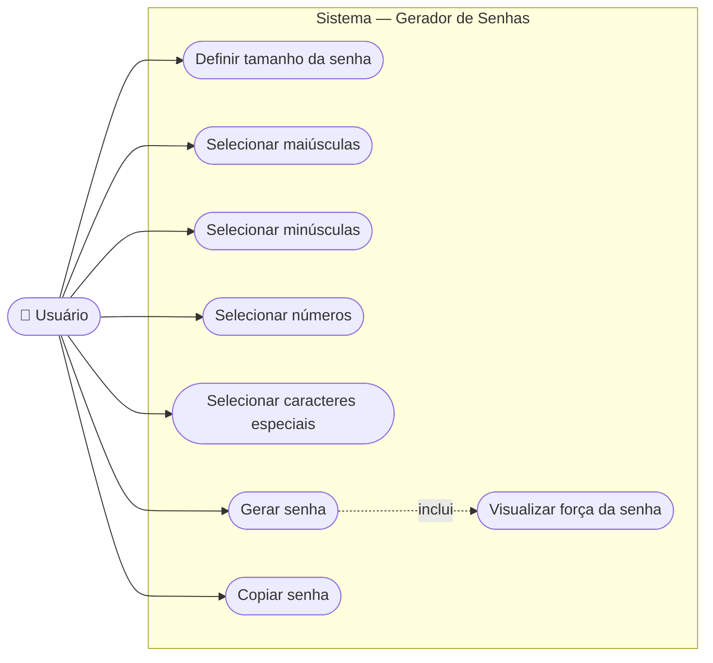

# Diagrama de Casos de Uso

## Descrição dos Casos de Uso

| Caso de Uso | Ator | Descrição |
|-------------|------|-----------|
| Definir tamanho da senha | Usuário | Seleciona um valor entre 8 e 128 via slider ou campo numérico |
| Selecionar maiúsculas | Usuário | Ativa/desativa a inclusão de letras A-Z |
| Selecionar minúsculas | Usuário | Ativa/desativa a inclusão de letras a-z |
| Selecionar números | Usuário | Ativa/desativa a inclusão de dígitos 0-9 |
| Selecionar caracteres especiais | Usuário | Ativa/desativa a inclusão de `!@#$%^&*()_+-=[]{}|;':",.<>?/` |
| Gerar senha | Usuário | Envia os critérios ao backend e recebe a senha gerada |
| Copiar senha | Usuário | Copia a senha exibida para a área de transferência com um clique |
| Visualizar força da senha | Sistema | Exibido automaticamente após a geração (incluso em "Gerar senha") |
