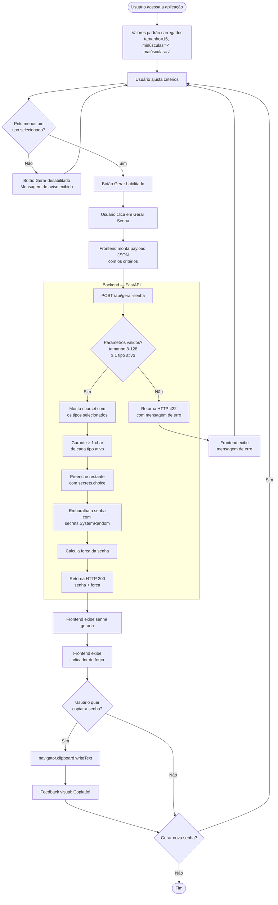

# Diagrama de Fluxo — Geração de Senha

## Cálculo da Força da Senha

| Força | Critério |
|-------|----------|
| **Fraca** | apenas 1 tipo de caractere **ou** tamanho < 10 |
| **Média** | 2 tipos de caracteres **e** tamanho ≥ 10 |
| **Forte** | 3 tipos de caracteres **e** tamanho ≥ 12 |
| **Muito Forte** | 4 tipos de caracteres **e** tamanho ≥ 16 |
