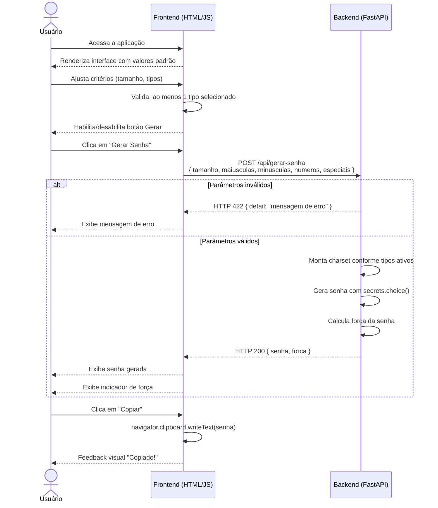

# Diagrama de Sequência — Interação Frontend ↔ Backend



## Contrato da API

### `POST /api/gerar-senha`

**Request Body**
```json
{
  "tamanho": 16,
  "maiusculas": true,
  "minusculas": true,
  "numeros": true,
  "especiais": false
}
```

**Response 200 — OK**
```json
{
  "senha": "aB3xYmQpLz7wNkRe",
  "forca": "forte"
}
```

**Response 422 — Unprocessable Entity**
```json
{
  "detail": "Pelo menos um tipo de caractere deve ser selecionado."
}
```

### Valores válidos

| Campo | Tipo | Restrição |
|-------|------|-----------|
| `tamanho` | `integer` | 8 ≤ valor ≤ 128 |
| `maiusculas` | `boolean` | — |
| `minusculas` | `boolean` | — |
| `numeros` | `boolean` | — |
| `especiais` | `boolean` | — |

> Ao menos um dos campos booleanos deve ser `true`.
