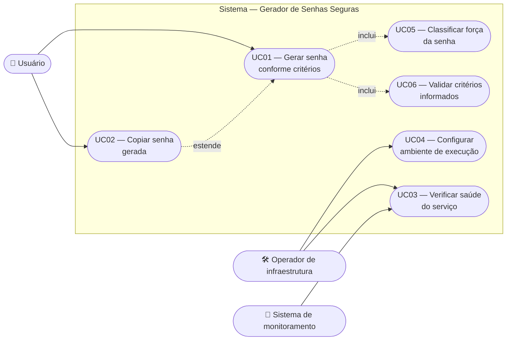

# Casos de Uso Expandidos — Gerador de Senhas Seguras

Este documento especifica os casos de uso no formato expandido (Cockburn): ator, pré-condições, fluxo principal, fluxos alternativos, fluxos de exceção e pós-condições.

Ele **complementa** o [diagrama de casos de uso](../docs/casos-de-uso.md) produzido na Fase 2 e o **corrige em um ponto**: aquele diagrama tratava cada interação de interface — *"Selecionar maiúsculas"*, *"Selecionar minúsculas"* — como caso de uso independente. Interações de tela não são casos de uso; casos de uso representam um objetivo do ator com valor observável ao final. Os oito itens originais foram reagrupados em **quatro casos de uso orientados a objetivo**, e as seleções passaram a ser passos internos do UC01. A justificativa dessa decisão está em [ELICITACAO.md](ELICITACAO.md#42-o-que-foi-modificado).

---

## Diagrama revisado

| Relação | Leitura |
|---------|---------|
| `UC01 inclui UC05` | Toda geração classifica a força — não é opcional |
| `UC01 inclui UC06` | Toda geração valida os critérios antes de produzir a senha |
| `UC02 estende UC01` | Copiar só existe se houve geração, mas a geração se completa sem a cópia |

> UC05 e UC06 são **subfunções**: não têm valor isolado para o ator, mas foram destacadas porque são reutilizadas e possuem regras próprias (RN06 e RN01/RN02).

---

## UC01 — Gerar senha conforme critérios

| Campo | Conteúdo |
|-------|----------|
| **Ator primário** | Usuário |
| **Escopo** | Sistema Gerador de Senhas Seguras |
| **Nível** | Objetivo de usuário |
| **Objetivo** | Obter uma senha aleatória que atenda aos critérios de tamanho e composição informados |
| **Interessados** | Usuário (quer senha forte e utilizável); operador (quer que o servidor não seja abusado) |
| **Pré-condições** | Aplicação carregada no navegador; backend acessível |
| **Garantia mínima** | Nenhuma senha é armazenada, logada ou reaproveitada, mesmo em caso de falha |
| **Garantia de sucesso** | Uma senha válida é exibida ao usuário, acompanhada da classificação de força |
| **Gatilho** | Usuário aciona o botão "Gerar Senha" |
| **Requisitos** | RF01–RF06, RF08, RF09, RN01–RN08, RNF01, RNF02, RNF05 |
| **Frequência** | Alta — é a razão de existir do produto |

### Fluxo principal

| # | Ator | Sistema |
|---|------|---------|
| 1 | Abre a aplicação | Carrega a interface com os critérios padrão (RN04): tamanho 16, maiúsculas e minúsculas ativas |
| 2 | Ajusta o tamanho no controle deslizante | Atualiza o rótulo do tamanho em tempo real |
| 3 | Marca ou desmarca os tipos de caractere | Reavalia a condição de RN01 e mantém o botão habilitado |
| 4 | Aciona "Gerar Senha" | Desabilita o botão e sinaliza o processamento ("Gerando…") |
| 5 | — | Envia `POST /api/gerar-senha` com os critérios vigentes |
| 6 | — | **Inclui UC06** — valida os critérios recebidos |
| 7 | — | Monta o charset com os tipos ativos e reserva um caractere de cada (RN03) |
| 8 | — | Completa o restante por sorteio com CSPRNG e embaralha o resultado (RN07, RNF01) |
| 9 | — | **Inclui UC05** — classifica a força |
| 10 | — | Responde `200 { senha, forca }`, sem registrar a senha em log (RNF02) |
| 11 | — | Exibe a senha, o indicador de força e habilita o botão "Copiar" |

### Fluxos alternativos

**A1 — Nenhum tipo de caractere selecionado (passo 3)**
1. O usuário desmarca o último tipo ativo.
2. O sistema desabilita "Gerar Senha" e exibe *"Selecione pelo menos um tipo de caractere."*
3. O caso de uso permanece no passo 3 até que um tipo seja marcado.

**A2 — Usuário mantém os valores padrão (passos 2 e 3)**
1. O usuário aciona a geração sem alterar nada.
2. O sistema segue do passo 4 com os padrões de RN04. *(Coberto por `test_body_vazio_usa_valores_padrao`.)*

**A3 — Nova geração com os mesmos critérios (após o passo 11)**
1. O usuário aciona novamente "Gerar Senha".
2. O sistema substitui a senha exibida por uma nova, obrigatoriamente diferente da anterior.
3. A senha anterior é descartada e não fica acessível na interface.

### Fluxos de exceção

**E1 — Critérios inválidos recebidos pela API (passo 6)**
1. UC06 detecta violação de RN01 ou RN02.
2. O sistema responde `422`, registra a rejeição em log (sem a senha) e não gera senha alguma.
3. O frontend exibe mensagem de erro e limpa o indicador de força.
4. O caso de uso termina em falha; a interface permanece utilizável.
5. **Divergência conhecida:** a resposta 422 carrega a lista de erros do Pydantic, e o frontend descarta esse conteúdo em favor de um texto genérico — ver [LA03](lacunas-ambiguidades.md#la03--mensagem-de-erro-da-api-não-chega-ao-usuário).

**E2 — Backend inacessível (passo 5)**
1. A requisição falha por rede ou por servidor fora do ar.
2. O sistema exibe *"Não foi possível conectar ao servidor. Verifique se o backend está em execução."*
3. O botão é reabilitado para nova tentativa; nenhuma senha é gerada localmente (RN08).

**E3 — Origem não autorizada (passo 5)**
1. O navegador bloqueia a requisição pela política de CORS (RNF04).
2. O comportamento observado pelo usuário é idêntico a E2.
3. *Lacuna:* o usuário não consegue distinguir bloqueio de configuração de indisponibilidade real — aceitável para o usuário final, insuficiente para o operador.

### Pós-condições

| Situação | Estado do sistema |
|----------|------------------|
| Sucesso | Senha e força exibidos na interface; backend sem qualquer registro da senha |
| Falha | Nenhuma senha exibida; mensagem de erro visível; barra de força zerada |
| Em qualquer caso | Backend permanece stateless (RNF10) |

---

## UC02 — Copiar senha gerada

| Campo | Conteúdo |
|-------|----------|
| **Ator primário** | Usuário |
| **Nível** | Objetivo de usuário |
| **Objetivo** | Transferir a senha exibida para a área de transferência do sistema operacional |
| **Pré-condições** | Uma senha foi gerada com sucesso (UC01 concluído) |
| **Garantia de sucesso** | A área de transferência contém exatamente a senha exibida |
| **Gatilho** | Usuário aciona o botão "Copiar" |
| **Requisitos** | RF07 |

### Fluxo principal

| # | Ator | Sistema |
|---|------|---------|
| 1 | Aciona "Copiar" | Lê o texto da senha exibida |
| 2 | — | Escreve o texto na área de transferência via `navigator.clipboard` |
| 3 | — | Altera o rótulo do botão para "Copiado!" |
| 4 | — | Restaura o rótulo "Copiar" após 2 segundos |

### Fluxos de exceção

**E1 — API de área de transferência indisponível (passo 2)**
1. O contexto não é seguro (por exemplo, página aberta via `file://`) e a API falha.
2. O sistema recorre ao mecanismo alternativo (elemento temporário + comando de cópia do navegador).
3. O fluxo segue do passo 3.
4. *Observação:* o mecanismo alternativo usa uma API depreciada. É dívida técnica conhecida, tolerada porque o caminho de uso previsto é HTTP local, onde `navigator.clipboard` funciona.

**E2 — Falha em ambos os mecanismos**
1. Nenhuma exceção é apresentada ao usuário e o botão exibe "Copiado!" mesmo assim.
2. *Lacuna registrada em [LA05](lacunas-ambiguidades.md#la05--confirmação-de-cópia-não-é-verificada).*

### Pós-condição relevante

A senha passa a existir fora do controle da aplicação, na área de transferência do usuário — inclusive após o fechamento da página. Essa é uma fronteira do requisito RNF02: a garantia de não persistência vale para o **sistema**, não para o ambiente do usuário. Fica registrada como premissa explícita.

---

## UC03 — Verificar saúde do serviço

| Campo | Conteúdo |
|-------|----------|
| **Ator primário** | Sistema de monitoramento (ou operador, manualmente) |
| **Nível** | Subfunção de operação |
| **Objetivo** | Determinar se a API está no ar e em qual versão |
| **Pré-condições** | Endereço do backend conhecido |
| **Gatilho** | Requisição periódica agendada ou verificação manual |
| **Requisitos** | RF11, RNF15 |

### Fluxo principal

| # | Ator | Sistema |
|---|------|---------|
| 1 | Emite `GET /health` | Responde `200 { status, version, timestamp }` |
| 2 | Registra a disponibilidade | — |

### Fluxo de exceção

**E1 — Sem resposta ou status diferente de 200**
1. O serviço é considerado indisponível.
2. *Lacuna:* nenhum destinatário de alerta está definido. Enquanto não houver monitor externo configurado, este caso de uso existe apenas como capacidade — risco [R15](../riscos/identificacao.md).

---

## UC04 — Configurar ambiente de execução

| Campo | Conteúdo |
|-------|----------|
| **Ator primário** | Operador de infraestrutura |
| **Nível** | Objetivo de usuário (fora do caminho do usuário final) |
| **Objetivo** | Publicar a aplicação com origens, portas e endereços corretos, sem alterar código-fonte |
| **Pré-condições** | Acesso ao servidor de implantação |
| **Garantia de sucesso** | Backend aceitando apenas as origens declaradas; frontend apontando para o backend correto |
| **Requisitos** | RNF04, RNF06, RNF07, RNF08, RNF16 |

### Fluxo principal

| # | Ator | Sistema |
|---|------|---------|
| 1 | Define `ALLOWED_ORIGINS` com as origens do frontend | Aplica a política de CORS na inicialização e registra em log a lista aceita |
| 2 | Define a porta do backend e a do frontend | Sobe os serviços nas portas informadas |
| 3 | Ajusta `API_URL` em `frontend/config.js` | Frontend passa a chamar o endereço configurado |
| 4 | Verifica UC03 | Responde ao *health check* |

### Fluxo de exceção

**E1 — `ALLOWED_ORIGINS` não definida**
1. O sistema assume `*` e registra a lista em log.
2. A aplicação sobe funcional, porém aberta a qualquer origem — risco [R02](../riscos/analise.md).
3. *Lacuna:* não existe modo estrito que recuse a inicialização em produção sem configuração explícita. Ver [LA08](lacunas-ambiguidades.md#la08--padrão-inseguro-de-cors-não-falha-de-forma-visível).

---

## UC05 — Classificar força da senha *(subfunção)*

| Campo | Conteúdo |
|-------|----------|
| **Incluído por** | UC01 |
| **Objetivo** | Atribuir um rótulo qualitativo de força à senha produzida |
| **Requisitos** | RF08, RN06 |

### Regra aplicada

Avaliada na ordem, retornando na primeira correspondência:

| Ordem | Condição | Resultado |
|-------|----------|-----------|
| 1 | ≥ 4 tipos **e** tamanho ≥ 16 | `muito forte` |
| 2 | ≥ 3 tipos **e** tamanho ≥ 12 | `forte` |
| 3 | ≥ 2 tipos **e** tamanho ≥ 10 | `média` |
| 4 | Qualquer outro caso | `fraca` |

**Limitação assumida:** a classificação ignora o tamanho efetivo do alfabeto. Ver [LA01](lacunas-ambiguidades.md#la01--força-não-mede-entropia) e HU12.

---

## UC06 — Validar critérios informados *(subfunção)*

| Campo | Conteúdo |
|-------|----------|
| **Incluído por** | UC01 |
| **Objetivo** | Garantir que os critérios recebidos são processáveis antes de gerar qualquer senha |
| **Requisitos** | RN01, RN02, RNF05 |

### Regras aplicadas

| Verificação | Violação resulta em |
|-------------|--------------------|
| `tamanho` inteiro no intervalo [8, 128] | `422` |
| Ao menos um tipo de caractere ativo | `422` |
| Campos ausentes | Preenchidos com os padrões de RN04 — não é violação |

A validação ocorre **sempre no servidor**, independentemente de o cliente já ter validado. O bloqueio no cliente é conveniência de usabilidade, não controle de segurança.

---

## Cobertura de requisitos pelos casos de uso

| Caso de uso | Requisitos funcionais cobertos |
|-------------|-------------------------------|
| UC01 | RF01, RF02, RF03, RF04, RF05, RF06, RF08, RF09, RF10 |
| UC02 | RF07 |
| UC03 | RF11 |
| UC04 | — (cobre RNF04, RNF16) |
| UC05 | RF08 |
| UC06 | RF09 |

Nenhum requisito funcional da baseline ficou sem caso de uso associado. A verificação completa está em [matriz-rastreabilidade.md](matriz-rastreabilidade.md).
