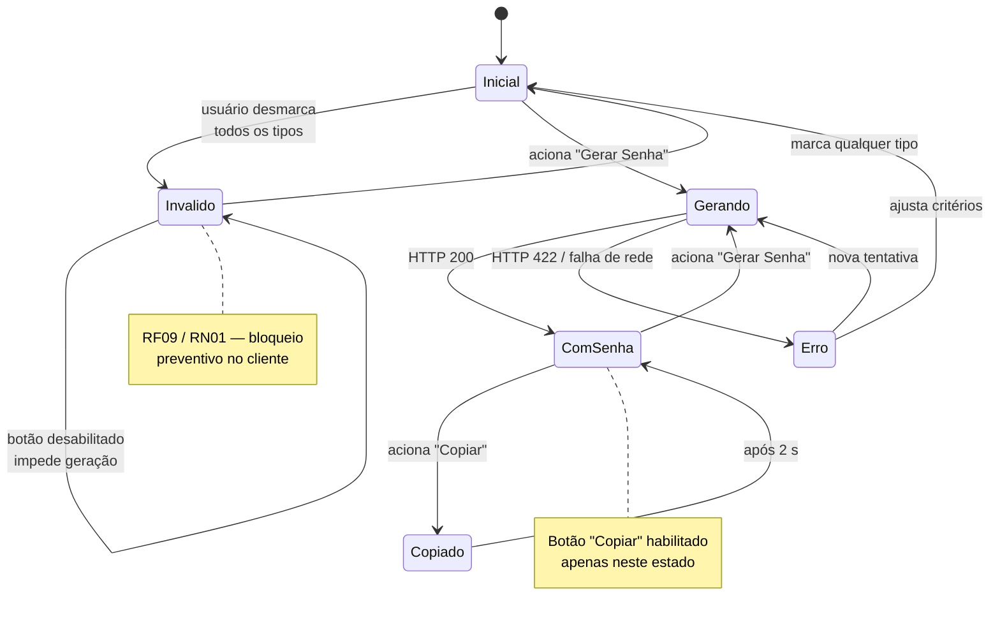

# Protótipo de Baixa Fidelidade — Gerador de Senhas Seguras

Protótipo em wireframe textual, usado na elicitação para validar **fluxo, estados e vocabulário** da interface — não estilo visual. A escolha por baixa fidelidade é deliberada: a tela é única e o ponto em discussão era o comportamento (quando o botão habilita, o que aparece em caso de erro), não a estética. Alta fidelidade custaria mais e discutiria a coisa errada.

Cada estado abaixo tem um requisito e um critério de aceitação correspondentes. A implementação final está em [frontend/index.html](../frontend/index.html).

---

## Mapa de estados da interface



---

## E1 — Estado inicial

Ao carregar, os critérios padrão de RN04 já estão aplicados e a geração está disponível de imediato — o usuário que só quer "uma senha boa" resolve com um clique.

```
┌──────────────────────────────────────────────────────┐
│              Gerador de Senhas Seguras               │
├──────────────────────────────────────────────────────┤
│                                                      │
│  ┌────────────────────────────────┐  ┌────────────┐  │
│  │ A senha aparecerá aqui         │  │  Copiar    │  │  ← desabilitado
│  └────────────────────────────────┘  └────────────┘  │
│                                                      │
│  [                                        ]          │  ← barra de força vazia
│                                                      │
│  ──────────────────────────────────────────────────  │
│                                                      │
│  Tamanho da senha: 16 caracteres                     │
│  8  ●━━━━━━━━━━━━━━━━━━━━━━━━━━━━━━━━━━━━━━━  128    │
│                                                      │
│  ┌ Tipos de caracteres ───────────────────────────┐  │
│  │  [x] Letras maiúsculas  (A–Z)                  │  │
│  │  [x] Letras minúsculas  (a–z)                  │  │
│  │  [ ] Números            (0–9)                  │  │
│  │  [ ] Caracteres especiais (!@#$…)              │  │
│  └────────────────────────────────────────────────┘  │
│                                                      │
│  ┌────────────────────────────────────────────────┐  │
│  │                  Gerar Senha                   │  │
│  └────────────────────────────────────────────────┘  │
└──────────────────────────────────────────────────────┘
```

**Requisitos exercitados:** RF01–RF05, RN02, RN04 · **Critérios:** HU01 e HU02, cenários de padrão.

---

## E2 — Critérios inválidos (nenhum tipo marcado)

O bloqueio é preventivo: o botão desabilita **antes** do acionamento, e o motivo aparece junto dos controles que o causaram — não em um alerta separado.

```
│  ┌ Tipos de caracteres ───────────────────────────┐  │
│  │  [ ] Letras maiúsculas  (A–Z)                  │  │
│  │  [ ] Letras minúsculas  (a–z)                  │  │
│  │  [ ] Números            (0–9)                  │  │
│  │  [ ] Caracteres especiais (!@#$…)              │  │
│  └────────────────────────────────────────────────┘  │
│                                                      │
│  ⚠ Selecione pelo menos um tipo de caractere.        │  ← role="alert"
│                                                      │
│  ┌────────────────────────────────────────────────┐  │
│  │              Gerar Senha  (inativo)            │  │  ← desabilitado
│  └────────────────────────────────────────────────┘  │
```

**Requisitos:** RF09, RN01 · **Critérios:** HU03, cenário "Bloqueio preventivo no cliente".

> **Decisão de elicitação:** a alternativa avaliada era deixar o botão ativo e mostrar o erro só depois da resposta 422 do servidor. Rejeitada — obriga uma ida ao servidor para informar algo que o cliente já sabe. A validação do servidor permanece, como controle de segurança (UC06).

---

## E3 — Processando

```
│  ┌────────────────────────────────────────────────┐  │
│  │                   Gerando…                     │  │  ← desabilitado
│  └────────────────────────────────────────────────┘  │
```

Estado curto, mas necessário: sem ele, um clique duplo dispararia duas gerações e a segunda sobrescreveria a primeira sem o usuário perceber qual senha foi copiada.

---

## E4 — Senha gerada

```
┌──────────────────────────────────────────────────────┐
│              Gerador de Senhas Seguras               │
├──────────────────────────────────────────────────────┤
│                                                      │
│  ┌────────────────────────────────┐  ┌────────────┐  │
│  │ aB3xYmQpLz7wNkRe               │  │  Copiar    │  │  ← habilitado
│  └────────────────────────────────┘  └────────────┘  │
│                                                      │
│  [██████████████████████            ]  Forte         │  ← 75%, aria-live
│                                                      │
│  ──────────────────────────────────────────────────  │
│                        …                             │
│  ┌────────────────────────────────────────────────┐  │
│  │                  Gerar Senha                   │  │
│  └────────────────────────────────────────────────┘  │
└──────────────────────────────────────────────────────┘
```

**Preenchimento da barra por nível:**

| Força | Barra | Rótulo |
|-------|-------|--------|
| `fraca` | 25 % | Fraca |
| `média` | 50 % | Média |
| `forte` | 75 % | Forte |
| `muito forte` | 100 % | Muito Forte |

**Requisitos:** RF06, RF07, RF08, RN06 · **Critérios:** HU04 e HU05.

> A senha é exibida em texto claro, sem opção de ocultar. Foi decisão consciente para a 1.0.0 — o usuário precisa conferir o que copiou. A alternativa (mascarar por padrão) está no backlog como HU/RF15, para uso em ambientes compartilhados.

---

## E5 — Cópia confirmada

```
│  ┌────────────────────────────────┐  ┌────────────┐  │
│  │ aB3xYmQpLz7wNkRe               │  │  Copiado!  │  │  ← 2 segundos
│  └────────────────────────────────┘  └────────────┘  │
```

**Requisitos:** RF07 · **Critérios:** HU07.
**Lacuna conhecida:** a confirmação aparece mesmo se a cópia falhar — ver [LA05](lacunas-ambiguidades.md#la05--confirmação-de-cópia-não-é-verificada).

---

## E6 — Falha na geração

```
│  ┌────────────────────────────────┐  ┌────────────┐  │
│  │ A senha aparecerá aqui         │  │  Copiar    │  │
│  └────────────────────────────────┘  └────────────┘  │
│                                                      │
│  [                                        ]          │  ← barra zerada
│                        …                             │
│  ⚠ Não foi possível conectar ao servidor.            │
│    Verifique se o backend está em execução.          │
│                                                      │
│  ┌────────────────────────────────────────────────┐  │
│  │                  Gerar Senha                   │  │  ← reabilitado
│  └────────────────────────────────────────────────┘  │
```

**Requisitos:** RF10 · **Critérios:** HU06 · **Fluxos de exceção:** UC01/E1 e UC01/E2.

Duas regras de comportamento fixadas aqui: a barra de força é **zerada** (para não sugerir que a senha antiga corresponde à tentativa atual) e o botão volta a ficar disponível imediatamente.

**Lacuna conhecida:** a mensagem de rejeição por critérios inválidos é genérica e não informa qual campo foi recusado — ver [LA03](lacunas-ambiguidades.md#la03--mensagem-de-erro-da-api-não-chega-ao-usuário).

---

## Decisões de interface registradas

| # | Decisão | Alternativa descartada | Motivo |
|---|---------|----------------------|--------|
| D1 | Tela única, sem navegação | Assistente em etapas | Um único objetivo; etapas adicionariam cliques sem valor |
| D2 | Controle deslizante com limites 8 e 128 visíveis | Campo numérico livre | Torna RN02 evidente na própria interface, sem mensagem de erro |
| D3 | Botão desabilitado em vez de erro após o clique | Validação apenas no servidor | Feedback imediato; ver E2 |
| D4 | Botão "Copiar" ao lado da senha | Copiar automaticamente ao gerar | Cópia automática sobrescreve a área de transferência sem consentimento |
| D5 | Barra de força + rótulo textual | Apenas cor | Cor sozinha exclui usuários com daltonismo (RNF12/RNF13) |
| D6 | Senha visível por padrão | Mascarada com botão revelar | Conferência visual do que será copiado; mascaramento vai para o backlog |

---

## O que o protótipo deixou em aberto

Itens que o wireframe não resolve e que seguem como questões da elicitação:

- **Lote de senhas (HU10):** a tela atual tem espaço para uma senha. Exibir de 2 a 10 exige repensar o bloco de exibição — provavelmente uma lista com botão de cópia por item.
- **Responsividade (RNF14):** o layout de card centralizado é adequado para desktop; nenhum breakpoint foi desenhado.
- **Estado sem JavaScript:** a página não tem comportamento definido com JS desabilitado — hoje ficaria inerte, sem aviso.
