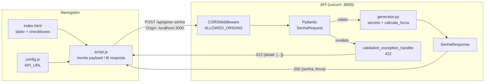

# Estratégia de Testes de Integração com GenAI

**Módulo 13 — Testes de Software Automatizados com Inteligência Artificial Generativa [C13 ES T1] · Unidade 3**

Modelo: Claude Opus 5.5 via Claude Code · Prompts completos em [PROMPTS.md](../PROMPTS.md#módulo-13-testes-de-software-automatizados-com-inteligência-artificial-generativa-c13-es-t1)

## Cenário de integração

Fluxo **front‑end ↔ back‑end** do Gerador de Senhas Seguras:



Os testes unitários existentes (`tests/test_*.py`) cobrem cada caixa isoladamente, com `TestClient` em memória. Os testes de integração cobrem as **setas**: o contrato entre o JavaScript e o Python, a passagem pelo middleware e o comportamento sobre um socket HTTP real.

## Os dois tipos de prompt

| | Prompt 01 — Cenários de integração + contrato de API | Prompt 02 — Casos de erro + dados de teste |
|---|---|---|
| **Pergunta que responde** | "Os dois lados concordam sobre o que trocam?" | "O que acontece quando a troca dá errado?" |
| **Técnica** | Teste de contrato dirigido pelo consumidor (*consumer-driven contract*, versão leve, sem Pact) + fluxo ponta a ponta | Testes negativos, análise de valor limite e testes orientados a dados |
| **Entrada para a LLM** | Código do frontend, do backend e o contrato documentado no README | Mesmo código + o detalhe de como o frontend trata erros (`resp.json()` antes de `resp.ok`) |
| **Saída** | [cenarios-integracao.md](cenarios-integracao.md) (CI-01 a CI-15) + 19 testes | [casos-de-erro.md](casos-de-erro.md) + [casos_erro.json](../backend/tests/integracao/dados/casos_erro.json) (25 casos) + 1 teste parametrizado |
| **Por que este tipo** | Frontend e backend estão em linguagens diferentes, sem tipos compartilhados. A divergência só aparece em tempo de execução, e um teste que lê os dois lados torna essa divergência visível no CI. | Erros são o ponto onde frontend e backend mais divergem: o caminho feliz costuma estar coberto, os erros não. A LLM é boa para enumerar entradas inválidas de forma sistemática. |

As técnicas usadas nos prompts foram: **papel** ("atue como engenheiro de QA…"), **contexto ancorado no código** ("leia os arquivos, não presuma"), **formato de saída explícito** (tabela com colunas definidas e JSON com campos definidos) e **restrições** (sem novas dependências, não alterar a aplicação, marcar com `@pytest.mark.integracao`).

## Como executar

```bash
make test-integracao
```

ou, dentro de `backend/`:

```bash
uv run pytest -m integracao
```

As fixtures em [conftest.py](../backend/tests/integracao/conftest.py) sobem a API com `uvicorn` em uma porta livre aleatória. Uma instância usa `ALLOWED_ORIGINS=*` e outra usa `ALLOWED_ORIGINS=http://localhost:3000`. As duas são encerradas ao final. Não é preciso ter o backend nem o Node.js rodando.

## Resultado

| Suíte | Testes | Passaram | Falharam |
|-------|-------:|---------:|---------:|
| `test_contrato_frontend_backend.py` (Prompt 01) | 7 | 7 | 0 |
| `test_fluxo_http_real.py` (Prompt 01) | 12 | 12 | 0 |
| `test_casos_erro_orientado_a_dados.py` (Prompt 02) | 25 | 22 | **3** |
| **Total** | **44** | **41** | **3** |

As três falhas têm a mesma causa raiz, o **defeito D-01**: o handler de validação devolve `500` em texto puro quando o erro contém objetos não serializáveis. Isso inclui a regra de negócio "nenhum tipo selecionado". A análise completa e a correção sugerida, de uma linha, estão em [casos-de-erro.md](casos-de-erro.md#defeitos-encontrados). Com a correção aplicada numa cópia do projeto, **134 de 134** testes passam (90 existentes + 44 novos).

## Revisão humana sobre o que a LLM gerou

| O que a LLM propôs / fez | Ajuste ou decisão |
|---|---|
| Rodar a integração com `TestClient` em memória, igual aos testes unitários | Trocado por **uvicorn em processo separado**. Com o `TestClient` a requisição não passa pelo socket, e o 500 aparecia como exceção Python em vez de resposta HTTP. |
| Testar o frontend com um navegador headless (Playwright) | Descartado: exigiria Node.js e novas dependências. O contrato é extraído do JS/HTML por expressões regulares, o que cobre a integração sem executar o navegador. |
| Tratar as coerções do Pydantic (`"16"` → 16) como erro | Reclassificadas como **decisão pendente** (CC-01 a CC-04). O frontend nunca envia esses valores, e mudar para `strict=True` é decisão de produto, não correção. |
| Corrigir o `main.py` ao encontrar o D-01 | **Não aplicado.** O exercício é sobre gerar testes. A correção foi validada numa cópia e fica documentada, e os testes continuam afirmando o comportamento correto. |
| Divergência entre o 422 documentado no README (`detail` string) e o real (`detail` lista) | Registrada em [cenarios-integracao.md](cenarios-integracao.md#divergência-com-a-documentação) como recomendação de correção da documentação. |

## Observações

- O defeito D-01 já era detectado por 2 testes unitários existentes, que falham com as versões atuais das dependências. Ou seja, a suíte estava vermelha e ninguém olhou. Isso reforça a recomendação dos "Próximos Passos" do README de rodar os testes em CI a cada *push*.
- A LLM só encontrou os gatilhos CE-04 e CE-05 (`text/plain` e formulário) porque o prompt pediu explicitamente casos de `Content-Type` incorreto. Pedir "casos de erro" de forma genérica tende a gerar apenas variações de valor (tamanho 7, 129…).
